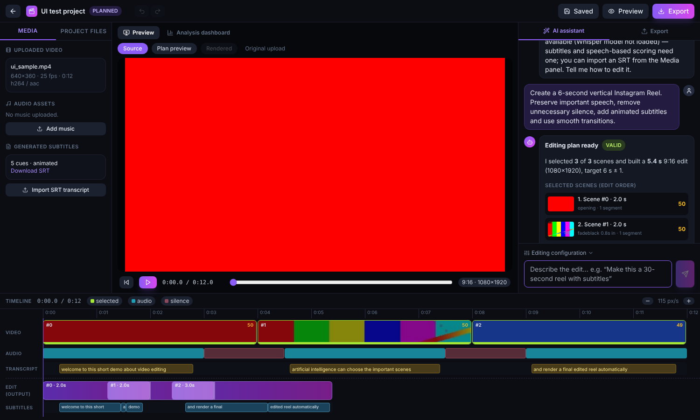

# ClipGenius AI
**An Intelligent Agent-Based Video Editing and Optimization System Using Artificial Intelligence**

Upload a video, describe the edit in plain language ("Create a 30-second vertical Instagram Reel, remove silence, animated subtitles, smooth transitions"),
review the plan an AI agent builds — scene scoring, **A\*** sequencing, **CSP** constraint validation, **rule-based expert system** — then render and download a verified MP4.

> Everything in the primary workflow runs **locally and offline** (CPU only, no paid API, no Docker). An LLM is optional and only produces JSON that Pydantic validates.



## Quick start

Requirements: **Python 3.11+**, **Node 18+**, **FFmpeg + FFprobe** on `PATH` (built/tested with FFmpeg 6.1, Python 3.12, Node 22).

```bash
# 1. backend
cd backend
python -m venv .venv && source .venv/bin/activate        # Windows: .venv\Scripts\activate
pip install -r requirements.txt
cp ../.env.example .env                                   # optional
uvicorn app.main:app --port 8000

# 2. frontend (dev server on :5173, proxies /api to :8000)
cd frontend && npm install && npm run dev
#   ...or build once; FastAPI then serves the UI itself at http://localhost:8000
cd frontend && npm install && npm run build
```

**Speech recognition.** `faster-whisper` downloads its model (`tiny` by default, ~75 MB) on first use and needs internet *once*.
If it cannot load, the app says so (status `unavailable` + the real error) and continues — scene detection, silence analysis, A\*, CSP, rendering all still work;
speech-based scoring and subtitles are reported as **missing**, never invented. Work-around: import an `.srt` (Media panel or `POST /api/projects/{id}/transcript`).

**Gujarati subtitles.** Noto Sans Gujarati (SIL OFL) is bundled in `backend/assets/fonts/` and passed to libass, so Gujarati + English captions render out of the box (verified visually). Add other fonts there for other scripts. Plans warn when text needs a font that cannot be found. Note: `tiny` Whisper is weak for Gujarati; set `CLIPGENIUS_WHISPER_MODEL=small` or `medium`.

## Tests
```bash
cd backend && python -m pytest tests -q          # 98 tests, ~3 min on 1 CPU core
python ../scripts/run_demo.py                    # reproducible demo -> docs/demo/*.json (measured values)
# realistic-input matrix: 46 cases (containers, rotation, VFR, audio layouts, every option) -> PASS/FAIL table with real errors
python ../scripts/feature_matrix.py /path/to/folder-with-test-videos
# browser test of every UI control (needs: pip install playwright && playwright install chromium; server running with the built UI on :8000)
python ../scripts/ui_e2e_full.py video.mp4 transcript.srt music.mp3
```
Tests use small FFmpeg-generated videos (no downloads). Whisper is stubbed in tests (third-party weights); everything else — FFprobe, PySceneDetect, OpenCV, FFmpeg rendering, ffprobe verification — is real.

## How the AI works (and where the code is)

| Stage | Technique | Source (own implementation unless noted) |
|---|---|---|
| Agent cycle (Perceive→Understand→Plan→Decide→Validate→Act→Evaluate), shared state, decision log | goal- & utility-based agent, PEAS | `ai/agent_controller.py`, `services/*.py` |
| Scene detection | PySceneDetect *ContentDetector* (**3rd-party**) + our pause-based splitting of long scenes | `ai/scene_detector.py` |
| Visual features | OpenCV histograms, frame-difference motion, motion-centroid for reframing | `ai/video_perception.py` |
| Transcription | faster-whisper (**3rd-party pretrained**) / SRT import | `ai/speech_analyzer.py` |
| Scene importance 0–100 | weighted normalised features, explicit missing-feature policy | `ai/scene_scorer.py` |
| **A\* sequencing** | heapq OPEN list, best-g table, **MST admissible heuristic**, beam fallback (flagged non-optimal) | `algorithms/astar.py`, `heuristic.py` |
| **CSP** | variables/domains/constraints, **backtracking + MRV + value ordering + forward checking**, failure diagnosis; independent post-validator gates rendering | `algorithms/csp.py`, `backtracking.py` |
| **Expert system** | 15 IF-THEN rules; **forward chaining** to fixed point; **backward chaining** proof trees | `algorithms/expert_system.py`, `forward_chaining.py`, `backward_chaining.py` |
| Prompt interpreter | deterministic regex parser → Pydantic `EditConfig`; optional LLM (JSON only) | `ai/prompt_interpreter.py`, `schemas/editing.py` |
| Rendering | FFmpeg filter graph (seeked inputs, xfade, ass, loudnorm, sidechain ducking) + FFprobe/decode verification | `rendering/*.py` |

Pipeline: `analyze → plan → (user reviews plan) → validate → render → verify`. A plan that fails validation is stored with an explanation and **cannot be rendered** (HTTP 409).

## API (all under `/api`)
`POST /projects` · `GET /projects` · `GET /projects/{id}` · `DELETE /projects/{id}` · `POST /upload?project_id=` · `POST /analyze/{id}` · `GET /analysis/{id}` ·
`POST /edit/{id}/plan` · `GET /edit/{id}/plan` · `POST /edit/{id}/validate` · `POST /edit/{id}/preview` · `POST /render/{id}` · `GET /render/{job_id}/status` · `GET /render/{job_id}/download` ·
`GET /agents/{id}/decisions` · `GET /algorithms/{id}/astar|csp|expert-system` · extras: `POST /projects/{id}/transcript` (SRT), `POST /projects/{id}/music`, `GET /edit/{id}/subtitles.srt`, `GET /report/{id}`, `GET /health`.
Interactive docs: http://localhost:8000/docs

## Security & reliability
Extension + MIME + **real content probe** on upload, streamed size limit, sanitised filenames, per-project directories, path-escape guard, only `ffmpeg`/`ffprobe` can be executed (never via a shell, always with timeouts),
LLM output parsed as JSON only, API keys only from env, no filesystem paths in responses, originals never modified, temp dirs cleaned, interrupted jobs reported after restart.

## Honest limitations
* **Whisper was not executable in the development sandbox** (no route to the model host). The integration is unit-tested with stubs and the unavailable-path is tested for real; a live transcription run has *not* been demonstrated here.
* On real videos, scene boundaries come from PySceneDetect cuts plus pause-based splitting (scenes > 8 s are split at pauses). Explicit *smooth/fade* requests apply a transition at every boundary (strong fade for real discontinuities, soft dissolve for jump cuts).
* The reproducible demo uses a **synthetic** 2-minute video (test patterns + tone bursts) and an imported SRT, so "speech activity" there is audio energy, not human speech. Re-run it on a real talking-head clip for a realistic demonstration.
* **Remotion** and **YOLO** are not integrated; FFmpeg + libass handle captions/transitions instead (documented alternative). Undo/redo is not implemented (plans are regenerated, not edited).
* Exact A\* is used up to 9 candidate scenes (n·2ⁿ states); beyond that beam search is used and labelled *not guaranteed optimal*. On the demo, A\* equals chronological order (the temporal term of the cost model favours it) — the result is reported as is.
* Importance weights are configurable defaults, not validated against human judgement. Word-level karaoke highlighting needs word timestamps (Whisper); SRT imports use proportional timing.
* "Plan preview" plays the planned segments from the original footage client-side (no transitions/subtitles); use *Quick preview* for a real render. Single-user; no authentication.
* The Playwright UI test and the feature matrix are manual scripts, not part of `pytest`. Tested on Linux only (font paths are relative so Windows should work, but it has not been run there).

See `docs/ACADEMIC_REPORT.md` (26-section report), `docs/DEMO_GUIDE.md`, `docs/VIVA_QA.md`.
